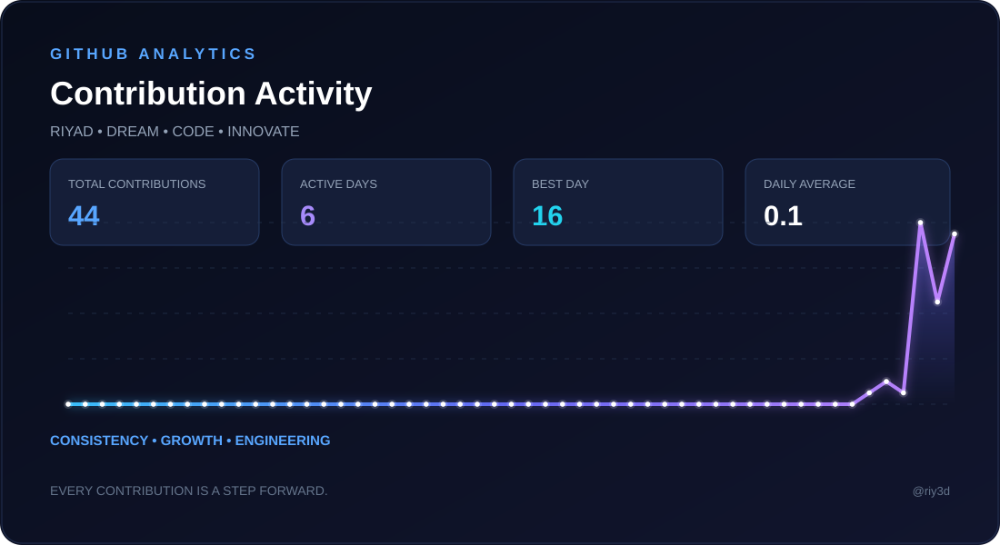

# Riyad Ayman Shoura

### Mathematics & Computer Science Student | Aspiring Data Engineer

 

  

---

<!-- ABOUT ME -->

<h2 align="center">👨‍💻 About Me</h2>

  <samp>MATHEMATICS • COMPUTER SCIENCE • DATA ENGINEERING</samp>

 

  Hi, I'm <b>Riyad Ayman Shoura</b>, a Mathematics &amp; Computer Science student
  at <b>Menoufia University, Egypt</b>.
    
  I'm passionate about understanding how data is collected, processed,
  structured, and transformed into reliable information and intelligent applications.
    
  My primary career direction is <b>Data Engineering</b>, with a growing interest
  in <b>Cloud Data Engineering, Database Systems, and Artificial Intelligence</b>.
    
  I enjoy combining mathematical thinking, programming, and engineering principles
  to solve practical problems and build meaningful solutions.

 

<h3 align="center">🎯 My Engineering Goals</h3>

  <samp>LEARNING • BUILDING • DESIGNING • INNOVATING</samp>

 

| # | Engineering Focus |
|:---:|:---|
| 01 | Building reliable, end-to-end data pipelines |
| 02 | Developing strong Python and SQL skills |
| 03 | Designing and managing relational database systems |
| 04 | Understanding modern data architectures and cloud infrastructure |
| 05 | Exploring AI-powered applications and recommendation systems |
| 06 | Transforming raw data into structured, meaningful information |

 

  <b>My Vision</b>
   
  <samp>Turning Data Into Knowledge. Engineering Ideas Into Solutions.</samp>

<!-- END ABOUT ME -->
---
<!-- TECHNICAL SKILLS -->

<h2 align="center">🛠️ Technical Skills</h2>

  <samp>PROGRAMMING • DATABASES • ENGINEERING • TOOLS</samp>

 

<!-- PROGRAMMING LANGUAGES -->

<h3 align="center">💻 Programming Languages</h3>

  

 

<!-- DATABASES & DATA ENGINEERING -->

<h3 align="center">🗄️ Databases &amp; Data Engineering</h3>

  

 

| Database & Engineering Skills |
|:---:|
| Relational Database Design |
| Database Modeling & Normalization |
| SQL Querying |
| ETL Fundamentals |
| Data Processing |
| REST API Integration |
| Web Scraping Fundamentals |

 

<!-- TOOLS -->

<h3 align="center">⚙️ Tools &amp; Development Environment</h3>

  

<h2 align="center">📊 GitHub Analytics</h2>

  <samp>MY DEVELOPMENT ACTIVITY • CONTRIBUTIONS • TECHNOLOGY STACK</samp>

 

<table>
<tr>
<td width="50%" align="center">
  
</td>
<td width="50%" align="center">
  
</td>
</tr>
</table>

 

  

<!-- FOCUS BADGES -->

  
  &nbsp;&nbsp;
  

 

<!-- END GITHUB ANALYTICS -->
---

<!-- CONTRIBUTION ACTIVITY DASHBOARD -->

<h2 align="center">⚡ CONTRIBUTION ACTIVITY</h2>

  <samp>BUILDING • LEARNING • ENGINEERING • GROWING</samp>

 

  

&nbsp;

&nbsp;

  

  <samp>EVERY CONTRIBUTION IS A STEP FORWARD.</samp>

<!-- END CONTRIBUTION ACTIVITY DASHBOARD -->
---

<!-- GITHUB METRICS DASHBOARD -->

<h2 align="center">📊 GitHub Metrics Dashboard</h2>

  <samp>PERFORMANCE • ANALYTICS • GROWTH</samp>

 

<!-- END GITHUB METRICS DASHBOARD -->

---

<!-- LET'S CONNECT -->

<h2 align="center">🤝 LET'S CONNECT</h2>

  <samp>
    OPEN TO COLLABORATION • KNOWLEDGE SHARING • NEW OPPORTUNITIES
  </samp>

  I'm always excited to connect with developers, engineers, and tech enthusiasts
  who share an interest in <b>Data Engineering, Software Development,
  Cloud Computing, and Artificial Intelligence.</b>
   
  Let's exchange ideas, learn together, and build meaningful things.

 

&nbsp;

&nbsp;

  

&nbsp;

&nbsp;

  

<h3>
  <samp>"Turning Data Into Insights, Ideas Into Innovation."</samp>
</h3>

  <samp>THANK YOU FOR VISITING MY PROFILE 💙</samp>

<!-- END LET'S CONNECT -->
